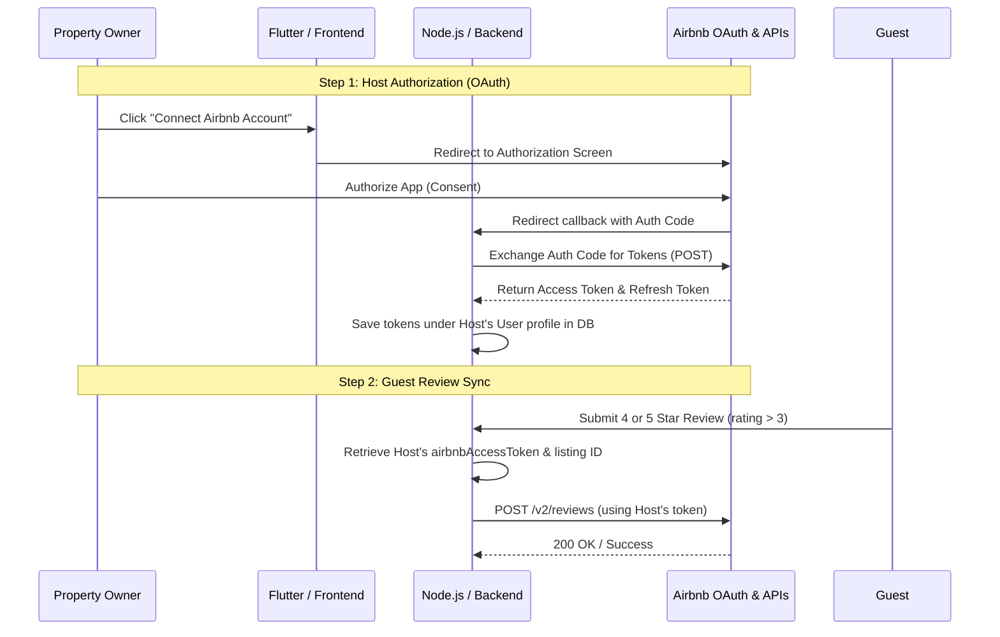

# Airbnb Review Sync Integration Guide
 
This guide focuses exclusively on how to set up, authorize, and sync guest reviews to Airbnb using the per-owner OAuth access token system.
 
---
 
## 1. Overall Sync Architecture
 

 
---
 
## 2. Step-by-Step Implementation Guide
 
### Step 1: Host Connects Airbnb (OAuth Flow)
 
To sync reviews to their listing, each host must authorize your app.
 
1. **Redirect Url Construction**:
   On your owner dashboard, redirect the host to Airbnb's authorization page:
   ```
   https://www.airbnb.com/oauth2/auth?
     client_id=<YOUR_AIRBNB_CLIENT_ID>
     &redirect_uri=https://your-api.com/api/v1/auth/airbnb/callback
     &scope=reviews_write
     &response_type=code
     &state=<host_user_id>
   ```
 
2. **Backend Callback Endpoint**:
   Create a route to handle the incoming redirection from Airbnb:
   ```typescript
   // auth.route.ts
   router.get("/airbnb/callback", AuthController.handleAirbnbCallback);
   ```
 
3. **Exchanging Authorization Code for Tokens**:
   Exchange the `code` for credentials and save them:
   ```typescript
   // auth.service.ts
   import axios from "axios";
   import prisma from "../../../shared/prisma";
 
   const exchangeAirbnbTokens = async (code: string, userId: string) => {
     const response = await axios.post("https://api.airbnb.com/v2/oauth2/authorizations", {
       client_id: process.env.AIRBNB_CLIENT_ID,
       client_secret: process.env.AIRBNB_CLIENT_SECRET,
       code: code,
       grant_type: "authorization_code",
       redirect_uri: "https://your-api.com/api/v1/auth/airbnb/callback",
     });
 
     const { access_token, refresh_token } = response.data;
 
     // Save to the host's user account
     await prisma.user.update({
       where: { id: userId },
       data: {
         airbnbAccessToken: access_token,
         airbnbRefreshToken: refresh_token,
       },
     });
   };
   ```
 
---
 
### Step 2: The Review Sync Trigger
 
When a guest leaves a review, the review service checks the rating and listing details.
 
1. **Date/Rating Check**:
   If `rating > 3` (4 or 5 stars), the review qualifies for Airbnb synchronization.
2. **Listing Identification**:
   The code extracts the Listing ID from the hotel's `airbnbIcalUrl`:
   ```typescript
   // Extracts "1608154622870243366" from "https://www.airbnb.com/calendar/ical/1608154622870243366.ics?t=..."
   const match = icalUrl.match(/\/ical\/(\d+)\.ics/);
   ```
3. **Execution**:
   The backend retrieves the host's `airbnbAccessToken` and sends the review payload:
   ```typescript
   await axios.post(
     "https://api.airbnb.com/v2/reviews",
     {
       listing_id: airbnbListingId,
       rating: rating,
       comments: comment,
       reviewer_id: guestUserId,
     },
     {
       headers: {
         Authorization: `Bearer ${ownerToken}`,
         "Content-Type": "application/json",
       },
     }
   );
   ```
 
---
 
### Step 3: Refreshing Expired Tokens
 
Airbnb access tokens are short-lived. If an API call fails with `401 Unauthorized`, automatically refresh it:
 
```typescript
const refreshAirbnbToken = async (userId: string, refreshToken: string) => {
  try {
    const response = await axios.post("https://api.airbnb.com/v2/oauth2/authorizations", {
      client_id: process.env.AIRBNB_CLIENT_ID,
      client_secret: process.env.AIRBNB_CLIENT_SECRET,
      refresh_token: refreshToken,
      grant_type: "refresh_token",
    });
 
    const { access_token, refresh_token: newRefreshToken } = response.data;
 
    await prisma.user.update({
      where: { id: userId },
      data: {
        airbnbAccessToken: access_token,
        airbnbRefreshToken: newRefreshToken,
      },
    });
 
    return access_token;
  } catch (err) {
    console.error("Could not refresh Airbnb tokens:", err);
    return null;
  }
};
```
